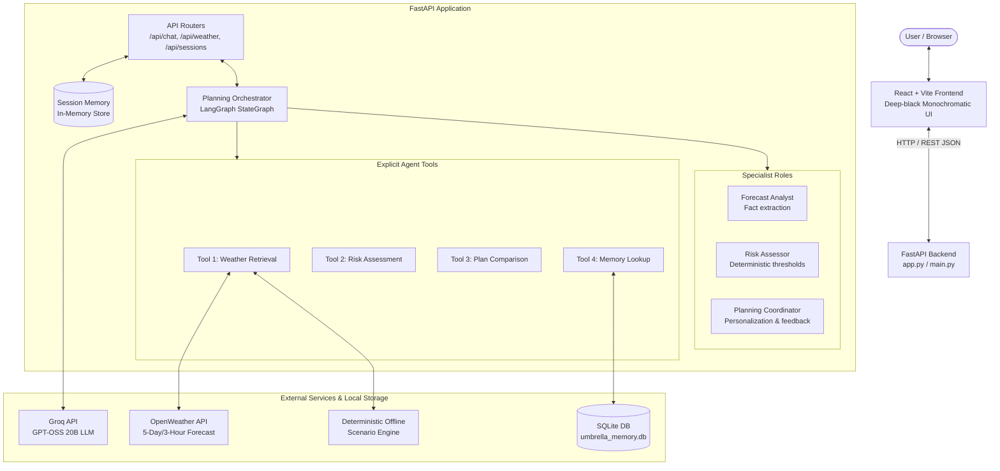

# Umbrella Architecture Documentation

## 1. High-Level Architecture Overview

**umbrella.** is an intelligent personal weather companion designed for context-aware weather planning and adaptive decision-making.

The architecture decouples the user experience from raw weather provider APIs using an agentic, tool-driven pattern:
- **Presentation Layer**: A minimal, conversation-first React application written in TypeScript and Tailwind CSS, utilizing Lucide React icons with a strict deep-black monochromatic visual palette (`#000000`, `#0A0A0A`, `#111111`, `#FFFFFF`).
- **Application & API Layer**: A high-performance FastAPI service providing REST endpoints for multi-turn chat, weather queries, plan comparison, and user preferences.
- **Orchestration Layer**: A bounded LangGraph state graph coordinating 4 explicit agent tools, 3 specialist roles, deterministic risk evaluation, and Groq LLM natural language explanations.
- **Persistence Layer**: In-memory session tracking for active conversational turns combined with SQLite persistent storage (`umbrella_memory.db`) for long-term user preferences and activity records.



---

## 2. Technology Stack

| Layer | Technologies | Rationale |
|---|---|---|
| **Frontend** | React 18, Vite 5, TypeScript 5, Tailwind CSS, Lucide React, Recharts | Fast HMR, production-grade bundling, strict type safety, zero emoji dependency, customizable dark glassmorphism. |
| **Backend** | Python 3.10+, FastAPI, Uvicorn, Pydantic v2 | Asynchronous request handling, automated OpenAPI documentation, strict request/response data contracts. |
| **Agent Orchestration** | LangGraph, LangChain Core, LangChain Groq | Bounded multi-step workflow with state tracking, structured handoffs, and deterministic fallbacks. |
| **Data Providers** | OpenWeather Forecast API (5-day/3-hour), Groq API (openai/gpt-oss-20b) | Standard meteorological endpoints with LLM summarization. |
| **Persistence** | SQLite (`umbrella_memory.db`) + In-memory Session Store | Local, zero-configuration relational persistence with parameterized queries and thread-safe session tracking. |

---

## 3. Folder Structure

```text
umbrella/
├── backend/
│   ├── main.py                     # FastAPI application entrypoint & middleware
│   ├── api/
│   │   ├── chat.py                 # POST /api/chat, GET /api/chat/history, POST /api/chat/reset
│   │   ├── weather.py              # GET /api/weather/forecast
│   │   └── sessions.py             # GET / POST /api/sessions/preferences
│   ├── models/
│   │   └── schemas.py              # Pydantic v2 data models for requests & responses
│   ├── services/
│   │   ├── weather_service.py      # OpenWeather client & offline scenario generator
│   │   ├── risk_service.py         # Deterministic risk engine & threshold classifier
│   │   ├── planning_service.py     # Activity slot overlap & Adaptive Plan Comparison
│   │   └── memory_service.py       # Session memory manager
│   ├── agents/
│   │   ├── orchestrator.py         # 7-step LangGraph planning orchestrator
│   │   └── tools.py                # Typed agent tool implementations
│   └── tests/
│       └── test_api.py             # FastAPI TestClient endpoint integration tests
│
├── frontend/
│   ├── src/
│   │   ├── components/
│   │   │   ├── Header.tsx                  # Slim header with Lucide Umbrella emblem
│   │   │   ├── WelcomeView.tsx             # Centered landing view & suggested prompts
│   │   │   ├── ChatComposer.tsx            # Floating conversational input & send action
│   │   │   ├── ChatMessageItem.tsx         # User & assistant messages with inline cards
│   │   │   ├── ForecastChart.tsx           # Recharts probability timeline with thresholds
│   │   │   ├── AdaptiveComparisonCard.tsx  # Side-by-side alternative schedule comparison
│   │   │   ├── AgentActivityTrace.tsx      # 7-step chronological execution timeline
│   │   │   └── SettingsModal.tsx           # Monochromatic settings & scenario selector
│   │   ├── types/index.ts          # TypeScript interfaces
│   │   ├── lib/utils.ts            # Formatting & class merging utilities
│   │   ├── App.tsx                 # Root application state & message loop
│   │   ├── main.tsx                # React DOM root mounting
│   │   └── index.css               # Tailwind CSS & glassmorphic styling
│   ├── package.json
│   ├── vite.config.ts
│   └── tailwind.config.js
│
├── legacy/
│   ├── app.py                      # Preserved legacy Streamlit dashboard
│   └── README.md                   # Legacy documentation
│
├── docs/
│   ├── ARCHITECTURE.md             # This document
│   ├── CODE_WALKTHROUGH.md         # File-by-file function walkthrough
│   └── TECHNICAL_QA.md             # Anticipated jury & technical Q&A
│
├── agent.py                        # Standalone Python module for backward compatibility
├── memory.py                       # Standalone SQLite persistent memory module
├── test_agent.py                   # Comprehensive unit test suite (21 tests)
├── requirements.txt                # Python backend dependencies
└── README.md                       # Master product documentation
```

---

## 4. Request Lifecycle

1. **User Input**: User submits a message via the conversational composer (e.g. *"I have college tomorrow from 9 to 4. Will I need an umbrella?"*).
2. **Frontend Dispatch**: React dispatches `POST /api/chat` with message, session ID, demo parameters, and advice preferences.
3. **Session Context Lookup**: FastAPI checks `SessionMemory`. If this is a follow-up, existing location and activity parameters are retained.
4. **Goal & Intent Interpretation**: Orchestrator parses activity type, destination, time window, and intent (`plan`, `compare`, `why`, `analytics`, `reset`).
5. **Tool Execution**:
   - `tool_memory_lookup`: Retrieves preference and caution adjustments.
   - `tool_weather_retrieval`: Queries OpenWeather API (or offline demo scenario).
   - `tool_risk_assessment`: Maps 09:00 – 16:00 to overlapping 3-hour forecast slots.
   - `tool_plan_comparison`: Evaluates candidate time windows within allowed flexibility.
6. **Specialist Role Collaboration**:
   - `Forecast Analyst`: Formats meteorological facts.
   - `Risk Assessor`: Applies deterministic thresholds.
   - `Planning Coordinator`: Harmonizes with user advice style.
7. **Explanation Generation**: Groq LLM (or deterministic fallback) summarizes the plan into natural, grounded text.
8. **Trace Assembly**: Exact millisecond durations and input/output contracts are recorded in `execution_trace`.
9. **Client Rendering**: React receives JSON payload, appends message to thread, and renders the inline weather card, comparison panel, and expandable tools.

---

## 5. Risk Calculation & Deterministic Rules

Umbrella enforces deterministic boundaries for safety and predictability:

$$\text{Risk Level} = \begin{cases} 
\text{LOW} & \text{if } \text{pop} < 30\% \\
\text{MODERATE} & \text{if } 30\% \le \text{pop} < 60\% \\
\text{HIGH} & \text{if } \text{pop} \ge 60\%
\end{cases}$$

- **Baseline Recommendation**:
  - `LOW`: *"No umbrella needed"*
  - `MODERATE`: *"Carry an umbrella just in case"*
  - `HIGH`: *"Definitely carry an umbrella"*
- **Advice Styles**:
  - `Conservative`: Alerts to carry an umbrella if $\text{pop} \ge 20\%$.
  - `Balanced`: Follows baseline thresholds.
  - `Relaxed`: Recommends carrying an umbrella only if $\text{pop} \ge 70\%$.
- **Invariance Rule**: Personalization changes advice phrasing, but **never overwrites the baseline risk classification**.

---

## 6. Adaptive Plan Comparison Algorithm

When a user requests schedule flexibility:
1. **Window Anchoring**: Identifies original window $W_{\text{orig}} = [t_{\text{start}}, t_{\text{end}}]$ and duration $D = t_{\text{end}} - t_{\text{start}}$.
2. **Candidate Generation**: Shifts start time by $\Delta t \in [-F \times 60, +F \times 60]$ in 60-minute increments, where $F$ is allowed flexibility hours. Candidates outside daytime hours (06:00 to 22:00) are discarded.
3. **Meteorological Evaluation**: For each candidate window $W_i$, overlapping forecast slots are evaluated for peak rain probability ($\text{pop}_i$) and risk band ($R_i$).
4. **Ranking Policy**:
   - Lower risk category ($\text{LOW} < \text{MODERATE} < \text{HIGH}$).
   - Lower peak rain probability ($\text{pop}_i$).
   - Minimal schedule shift ($|\Delta t|$).
5. **Significance Threshold**: A candidate is recommended if it reduces the risk band or lowers peak probability by $\ge 15\text{ percentage points}$. Otherwise, the original plan is confirmed as optimal.

---

## 7. Security & Credential Hygiene

- **Server-Side Isolation**: All API keys (`OPENWEATHER_API_KEY`, `GROQ_API_KEY`) reside exclusively in backend environment variables or server memory. Keys are never transmitted to the frontend.
- **No Shared State Mutation**: Functions take explicit credentials as arguments rather than writing user values into global `os.environ`.
- **Exclusion in Version Control**: Local databases (`*.db`, `*.sqlite3`) and environment files (`.env`) are excluded in `.gitignore`.
- **CORS Protection**: Restricted to authorized origins (`http://localhost:5173`, `http://127.0.0.1:8000`).
